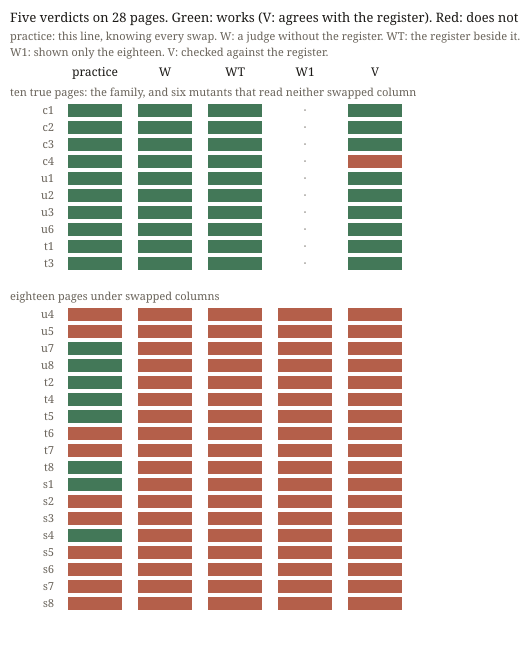

# The Dog Register

**Experiment 32 of the project *How a machine practises artistic research*. Operation: judging, with varying.**

Experiment 31 swapped whole columns of the periodic table under one maker's page, and a fresh judge refused every
page that misstated the elements. It could have refused them from memory. Tonight the arrangement is the same, but
the table is one nobody knows by heart: **Zürich's dog register**, 10,106 dogs on 30 September 2026. Four fresh
makers again made one form four times: every dog a square in its coat colour, by year of birth. All four found the
same thing in the register: almost none of the dogs born since 2024 has a colour recorded. The drawn parent was
rewired 24 times. The face puts you in the judge's seat first. Does this page work?

**What came out.** Six swaps touched no column the page reads. Eighteen changed the picture, and none broke it.
**Judge W, without the register, refused all eighteen and passed all ten true pages.** Judge WT had the register
beside it, parsed it, and returned the same 28 verdicts. Reader V checked every page against the register and
called all eighteen false. The figure 2,729 (dogs with no colour) appears in W's reasons, and W could only have read
it off the true pages in its packet. So, after the results and before it ran, the practice added a judge **W1** that
was shown only the eighteen. W1 refused all eighteen too, and never named 2,729. Its reasons hold each page to its own
words: *"the bands are the holders' age groups (10–80) rather than the dogs' years of birth"* (s1). The norm was
neither memory nor the other pages. It was **the page's own subtitle and captions**. The maker wrote them in code
from the true register, and a swap cannot move them. P1, P3, P5 and P8 failed. P2, P4, P6, P7 and P9 held, and so
did both added predictions. `S145.BINDING` held.

**What it answers to.** *Cartography, not Tracing*: the map *"belongs to performance"*, the tracing *"invokes an
alleged competence"* (ATP 12–13, as that text gives them). WT had contact with the real in reach and used it, and
contact added nothing. The judges did not trace the material. They held each page to the competence it claims for
itself. The standing sentence says error is a difference onto which an observer has *already* imposed a norm. Here
the norm was imposed before any judge arrived, by the maker, inside the work.

**Sources.** Stadt Zürich, Hundekontrolle der Stadtpolizei, *Aktueller Hundebestand der Stadt Zürich*, Open Data
Zürich, CC0, <https://data.stadt-zuerich.ch/dataset/sid_stapo_aktueller_hundebestand_monat_od1003>, fetched
2026-10-21 (hash in `sources/MANIFEST.json`). *Cartography, not Tracing* (`n-1/foundation/`), citing Deleuze and
Guattari, *A Thousand Plateaus*, pp. 12–13. Evidence: `PREDICTIONS.md`, `results.json`, `coder/`, `rooms/`,
`practice-verdict.json`, `rebind-core.js` (experiment 31's operator, unchanged).

## What this taught the project

When a machine practice judges a data work it cannot check, it does not fall back on liking the form. It reads the
work as a set of promises and checks the drawing against them. A maker of this family writes those promises in as it
makes the work: a subtitle, an axis, a count computed from the material. So the work carries its own norm, and a
judge needs neither memory nor the data to apply it. Giving the judge the data changed nothing it said. For this
practice, then, *works* already contains *true* only as far as the work says what it is. The practice's own verdicts
were the exception: knowing every swap, it again passed eight of the lying pages for their look. That leaves an open
question for the next experiment of this kind. Would a page that lies and promises nothing pass?
